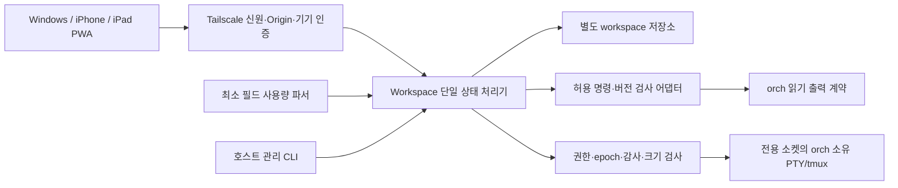

# Workspace v1 implementation design

상태: **검토용 구현 설계 제안**, 2026-11-17. 기존 요건·기술·실행·보안·화면 설계가 우선합니다. 새 계약은 아래 결정 항목을 승인하고 기존 문서·ADR에 반영한 뒤 구현합니다. 문서 작성은 기능 구현·실측·착수 승인 완료를 의미하지 않습니다.

- 코드 기준: main [`1b6f6d2`](https://github.com/2muni-labs/orchestrator/commit/1b6f6d279c8ff8a02830f7c5d85cef16376a53a1), v0.15.0.
- 시각 제안: [PR #145](https://github.com/2muni-labs/orchestrator/pull/145), HEAD `bb9993a22f8efa1449db82713555a92fa9662453`, 조회 당시 OPEN. 직접 closing issue는 없고 [#302](https://github.com/2muni-labs/orchestrator/issues/302)가 이력 이슈입니다.
- 실행 순서: [구현 계획](../plans/workspace-implementation-plan.md). 기존 계약: [기술 설계 4.13~4.15](기술%20설계.md), [보안 설계](보안%20설계.md), [화면 설계](화면%20설계.md).

## 1. 기준 코드와 범위

| 영역 | 확인한 구현 | 남은 계약 |
| --- | --- | --- |
| 패키지 | `src/orch/` 존재, `workspace/` 없음 | 독립 서버·클라이언트·검증 묶음 |
| CLI | status/doctor/watch/service/open 존재 | M17 show/events, M19 roadmap/versions/input_wait |
| 스키마 | `schemas/cli/{status,doctor,show,events}.v1.json` 존재 | 실제 출력의 준수 시험. 스키마 존재는 명령 구현 증거가 아님 |
| 터미널 | `terminal/base.py`는 생성 pane 기록, `terminal/tmux.py`는 argv 호출 | 전용 소켓, 권한, 스트림, 크기 제어 |
| 입력 | `terminal_send`는 non-main pane에 문자열과 Enter 전달 | 브라우저 main 터미널 입력에 그대로 재사용할 수 없음 |
| UI | 확정 화면 설계와 [#145](https://github.com/2muni-labs/orchestrator/pull/145) 정적 시안 | 제품 코드·실기기 인수 없음 |

확정 v1: 기존 터미널 연결, 파이프라인 읽기, dwindle/master·분할·탭·플로팅·가상 화면·스크래치패드, 키보드/터치와 10종 패널. orch 실행 버튼·머지·upgrade·임의 셸 생성·ACP·OTLP·시간축은 v1 밖입니다.

#145의 비율 기반 dwindle 방향, fullscreen/maximize/pin, 배경화면·효과 수준은 **조건부 확장**입니다. 승인 전에는 확정 화면 설계의 방향 교대 규칙을 유지합니다. WS-10~14와 인수 시나리오 12~16은 제안 범위로 추적합니다.

## 2. 결정 목록

| ID | 제안 / 확정할 사항 | 추적 이슈 |
| --- | --- | --- |
| D01 | #145의 공유 fullscreen/pin·분할 방향·호스트 이미지 등록 승인/수정/보류. ADR 0021/0022는 main에서 다른 결정이 사용 중이므로 제안 ADR과 참조를 재번호화. #487의 0024도 충돌 검사 | [#349](https://github.com/2muni-labs/orchestrator/issues/349), [#302](https://github.com/2muni-labs/orchestrator/issues/302) |
| D02 | terminal 크기는 현재 입력 소유 기기의 명시적 resize만 적용. 나머지는 같은 문자 격자를 스크롤. 소유자 부재 시 마지막 크기 유지 | [#350](https://github.com/2muni-labs/orchestrator/issues/350) |
| D03 | 탭은 split tree 잎의 panel 묶음, active tab은 공유. leaf=panel인 기존 설계를 leaf=tab_group으로 개정 | [#351](https://github.com/2muni-labs/orchestrator/issues/351) |
| D04 | lock/unlock·권한 관리 host-only, durable lock과 input 직렬 처리. 브라우저에 unlock/grant 없음 | [#352](https://github.com/2muni-labs/orchestrator/issues/352), [#335](https://github.com/2muni-labs/orchestrator/issues/335) |
| D05 | W-M6/W-M7/선택 스택 S-M3 뒤 언어·서버·PTY/WS·패키지 관리자·설치 스크립트 차단 방식 확정. PWA는 ADR 0011의 1차 선택 | [#330](https://github.com/2muni-labs/orchestrator/issues/330), [#331](https://github.com/2muni-labs/orchestrator/issues/331) |
| D06 | local-only는 기기별 보기만 변경, 구조 변경은 공유 모드 복귀 후 수행. view 기기는 레이아웃 조작 가능하되 input/resize/claim 불가 | [#335](https://github.com/2muni-labs/orchestrator/issues/335), [#337](https://github.com/2muni-labs/orchestrator/issues/337), [#351](https://github.com/2muni-labs/orchestrator/issues/351) |
| D07 | 로그/diff/process/terminal 최소 read-model 계약 추가. workspace의 임의 파일 읽기나 DB 직접 조회로 공백을 메우지 않음 | [#336](https://github.com/2muni-labs/orchestrator/issues/336), [#339](https://github.com/2muni-labs/orchestrator/issues/339), [#341](https://github.com/2muni-labs/orchestrator/issues/341) |
| D08 | 자원·메시지·버퍼·패널·보존 상한을 실측 후 고정. 수치를 제품 기본값으로 임의 확정하지 않음 | [#413](https://github.com/2muni-labs/orchestrator/issues/413), [#416](https://github.com/2muni-labs/orchestrator/issues/416) |
| D09 | 여러 대상에 대한 최소 sandbox 허용 목록과 target별 권한. pin은 허용 대상 안에서만 전역 표시 | [#333](https://github.com/2muni-labs/orchestrator/issues/333), [#335](https://github.com/2muni-labs/orchestrator/issues/335), [#337](https://github.com/2muni-labs/orchestrator/issues/337) |

각 결정은 계획 P00/P01에서 기존 문서·ADR에 반영합니다. 미확정인 항목을 구현 서브가 추측하지 않도록 dependent task의 착수 조건으로 둡니다.

## 3. 구성과 신뢰 경계



제안 디렉터리(언어·파일 확장자는 D05에서 확정):

```text
workspace/
  server/{auth,state,protocol,pipeline,terminal,usage,assets}/
  client/{transport,layout,panels,input,appearance}/
  tests/{unit,contract,integration,e2e,security}/
schemas/workspace/             # 메인 소유 JSON Schema 2020-12
```

파이프라인 → workspace import는 금지합니다. workspace가 없어도 pipeline 설치·실행·검증이 가능해야 합니다. workspace 의존성은 별도 manifest/lock으로 준비 단계에서만 설치합니다.

서버는 읽기 명령을 고정 argv로만 호출합니다. target은 등록 목록으로 검증하며 클라이언트가 실행 파일·파일 경로·tmux 명령을 지정하지 못합니다. 인증은 네트워크 신원과 allowlist를 대조하고 client가 보낸 device id/proxy header를 신뢰하지 않습니다. HTTP·WS 모두 인증하고 Origin은 정확한 allowlist로 검사합니다. 기기 회수는 기존 연결에도 적용합니다.

TLS 종료·신원 검증 API·세션 만료·Origin 구성은 W-M7로 한 경로를 확정합니다. 실패 시 인증과 입력을 거부합니다. sandbox는 승인된 대상별 최소 경로와 workspace 저장소만 허용합니다. 여러 target을 위한 최소 manifest는 호스트가 전달하고 변경 시 재시작·검증합니다. 홈이나 `~/.orch` 전체 허용은 하지 않습니다. config 전체·secrets·인증 파일·키체인에는 접근하지 않습니다.

## 4. 공유 상태와 전송 계약

별도 `~/.orch/workspace/` 저장소에 SQLite 트랜잭션 사용을 제안합니다. driver·backup은 D05에서 검증합니다. pipeline의 state.db에는 쓰지 않습니다.

| 상태 | 필드와 불변식 | 범위 |
| --- | --- | --- |
| Workspace | id, target, layout mode, root, floating ids, focus, 조건부 fullscreen | 공유·영속 |
| Node | split(axis,ratio,children) 또는 tab_group(panel_ids,active_id), 순환·중복 parent 금지 | 공유·영속 |
| Panel | id/type/target 및 task/run/terminal reference, client 경로 없음 | 공유·영속 |
| Global view | active workspace, 조건부 pinned ids, scratchpad | 공유, target scope 적용 |
| Device view | local-only, local workspace/focus/tab, effective effects | 서버 device별, 공유 snapshot도 계속 수신 |
| Terminal | socket/session/pane/생성 세대를 포함한 identity, owner, epoch, rows/cols, alive | 재시작 시 lease 해제 |
| Security | locked, permission revision, allowlist | 영속, 손상·검증 불능 시 잠금 |
| Transport | server epoch, revision, operation receipts, target별 pipeline cursor | 유실·중복·재접속 복구 |

레이아웃 처리 순서: 인증·대상 → base revision 확인 → 상태 전이 검증 → 상태와 operation receipt를 함께 commit → ack/delta 방송. 오래된 revision은 충돌로 거부하고 snapshot을 줍니다. 저장 실패 시 성공 ack가 없습니다. 한 client는 구조 변경 한 건씩 확정하고 drag는 최신 미전송 위치만 합칩니다.

메시지 후보(실제 schema는 P02에서 작성):

```json
{
  "protocol_version": 1,
  "type": "layout.command",
  "operation_id": "device-session:42",
  "server_epoch": "server-session",
  "base_revision": 17,
  "workspace_id": "ws-example",
  "action": {"kind": "focus", "panel_id": "panel-example"}
}
```

| 메시지 | 의미 |
| --- | --- |
| hello/snapshot | 인증 후 version·capabilities·epoch·revision·허용 상태 |
| layout.command/ack/delta | 같은 operation id는 결과 재사용, 다른 payload 재사용은 거부 |
| terminal.claim | input 권한·현재 epoch 검사, owner 교체, epoch 증가, 이전 기기 통지 |
| terminal.input | owner/epoch/lock/alive/rate 확인 후 전송. layout revision과 분리 |
| terminal.resize | 소유자 정수 rows/cols 검증·합치기 후 실제 크기 방송 |
| terminal.output | session별 sequence, bounded buffer, backpressure |
| pipeline.event | 원본 event id로 중복 제거, layout revision과 별개 |
| error/resync_required | 비밀 없는 이유 코드와 복구 행동 |

- 읽기 계약의 알 수 없는 추가 필드는 무시하고 breaking version은 거부합니다. mutation은 action과 필드를 엄격히 검사합니다. pipeline 한 계약만 미지원이면 해당 패널만 끄고, 인증/input protocol 미지원이면 입력을 차단합니다.
- 재접속 시 epoch/revision/cursor를 보내며 보존 범위이면 delta, 아니면 snapshot입니다. 재시작은 새 epoch를 발급합니다. cursor 공백·역전·보존 만료 시 snapshot 재조회를 합니다.
- snapshot 수집 중 이벤트 버퍼링·재대조를 시험합니다. 원자적 snapshot/watermark가 현재 CLI 계약에 없으므로 필요 시 M17에서 먼저 추가합니다. 구현이 없는 완전한 복구 계약을 가정하지 않습니다.
- 끊긴 연결에서 입력을 즉시 막고 **미확인 키 입력을 재전송하지 않습니다**. receipt 보존 기간이 지난 layout operation도 자동 재생하지 않고 snapshot에서 다시 의도합니다.
- 승인된 buffer 상한 초과는 resync로 전환합니다. 화면 밖 panel은 렌더를 멈추고 데이터 구독도 상한 안에서만 유지합니다.

## 5. 탭·레이아웃·기기별 보기

### 탭과 local-only (D03/D06)

leaf는 하나 이상의 panel과 active id를 갖는 tab group입니다. 단일 패널도 같은 형태입니다. group은 tile 한 개이지만 숨긴 탭도 panel/stream 예산에 포함합니다. 추가·재정렬·그룹 이동은 원자적으로 처리하고 같은 panel을 여러 container에 넣지 않습니다.

마지막 탭 제거 시 leaf를 제거하고 형제가 부모 자리를 차지합니다. 활성 탭을 닫으면 오른쪽, 없으면 왼쪽 탭을 활성화합니다. 포커스와 active 변경은 같은 transaction입니다. panel 닫기는 화면 참조 제거이며 프로세스를 kill하지 않습니다. 탭 분리는 새 leaf를 만듭니다.

dwindle split와 master 주 영역은 tab group 단위입니다. master는 leaf 순서로 표시하면서 원래 split 방향·비율을 보존합니다. 좁은 화면은 active leaf 하나와 tab strip을 보여 줍니다. swipe는 leaf 이동, tab 선택은 group 내부 이동이며 키보드와 팔레트로도 제공합니다.

local-only는 workspace/focus/tab과 조건부 fullscreen의 기기별 보기만 바꿉니다. 구조 변경·pin·배경 공유 설정은 공유 모드 복귀 후 수행합니다. terminal 권한·owner·lock은 그대로 전역입니다. 해제하면 최신 shared 상태로 돌아오고, 그동안 삭제된 panel은 유효 leaf나 빈 화면으로 대체합니다.

### PR [#145](https://github.com/2muni-labs/orchestrator/pull/145) 조건부 동작 (D01)

- dwindle 방향은 조작 기기가 계산해 요청하고 서버가 저장합니다. 다른 viewport가 방향을 다시 쓰지 않습니다. master에서 추가한 leaf의 저장 방향도 명령에 포함해 dwindle 복귀를 결정적으로 만듭니다.
- ratio 검증·중복 parent 거부·삭제 후 압축·순서 보존은 순수 함수로 시험합니다. 최소 크기 미달은 해당 client만 좁은 표시로 바꾸고 tree를 수정하지 않습니다.
- fullscreen/maximize는 tree 밖 overlay reference입니다. 수동 panel 추가는 해제, 자동 로그는 뒤에 배치하고 알림만 표시합니다. 해제 시 원래 tree/float 위치로 돌아갑니다.
- pin은 panel 단위입니다. 탭을 pin하면 group에서 분리해 floating으로 만든 뒤 pin합니다. 해제하면 현재 workspace의 floating이 됩니다. target 권한은 계속 검사합니다.
- pinned panel focus는 fullscreen 대상을 바꾸지 않는 예외를 제안합니다. #145의 focus 이동 규칙과 정합화하는 결정을 #349에 남깁니다.
- 좁은 화면의 pin은 타일 위 작은 창으로 겹치지 않고 pin 줄에서 선택해 sheet로 엽니다. 승인 대기와 입력 잠금은 sheet에도 표시하며, 닫으면 기존 포커스로 복귀합니다.
- float 좌표는 비율로 저장하고 화면 밖 보정은 렌더에만 적용합니다. 승인 대기·lock·연결 상태는 어떤 overlay에서도 보입니다. Esc는 터미널에 남기고 나가기 조작을 양쪽 입력 수단에 제공합니다.

### terminal 행·열 (D02)

1. terminal session당 PTY 한 개와 rows/cols 한 쌍입니다. 각 기기가 별도 PTY/셸을 만들지 않습니다.
2. input owner의 명시적 resize만 적용합니다. claim 자체는 마지막 크기를 유지합니다. 보기 기기·숨긴 탭·local-only·포커스 변경은 PTY 크기를 바꾸지 않습니다.
3. owner는 글꼴 측정·animation 완료 뒤 resize를 한 번 보내고 연속 drag는 합칩니다. 서버는 정수·범위·rate를 검사합니다. 다른 기기는 같은 문자 격자를 스크롤/확대합니다.
4. owner 교체는 epoch를 올려 이전 연결의 지연 input/resize를 거부합니다. 연결 종료·회수·재시작은 lease 해제, lock은 모든 lease 무효화입니다.
5. 실제 tmux 버전의 window-size 정책과 SSH attach의 크기 간섭을 측정합니다. terminal이 window인지 pane인지, PTY/stream 구현 방식은 P04 이전에 확정합니다. 브라우저 한 곳의 성공으로 완료하지 않습니다.

## 6. 입력과 호스트 제어

입력·claim·lock·권한 회수는 같은 직렬 처리기를 통과합니다. 각 입력마다 인증 세션, target/pane 소유 증거, input permission, epoch, lock, alive, 크기/rate를 확인합니다. 거부된 입력은 PTY에 도달하면 안 됩니다.

lock 성공 응답 전 durable lock을 저장하고 queue를 비우며 epoch를 올립니다. 응답 뒤에는 새 입력이 전달되지 않습니다. 이미 PTY로 보낸 바이트를 회수했다고 주장하지 않습니다. unlock은 host-only이며 lease는 복원하지 않습니다. 감사/DB 실패·손상 복구 중에는 입력을 막습니다.

제안 명령(아직 미구현):

| 명령 | 호출·효과 | 성공 기준 |
| --- | --- | --- |
| `orch workspace serve` | launchd + 별도 sandbox | bind/auth/store 확인 후 ready |
| `orch workspace lock` | host local IPC, 보기 유지 | durable lock 및 입력 차단 확인 |
| `orch workspace unlock` | host local IPC만, browser endpoint 없음 | 확인 후 unlock 저장, lease 없음 |
| 기기 등록·권한·회수 | host-only, 문법은 P01에서 고정, 기본 view | 현재 연결 회수·재검증 |
| `orch workspace wallpaper add <file>` | D01 승인 시 host-only | 안전한 asset id 반환 |

서버 정지 중 lock은 durable marker로 기록하고 다음 시작에서 먼저 읽습니다. 정지 중 unlock은 거부하여 재시작 후 명시적으로 해제하는 안을 제안합니다. IPC는 사용자 소유 Unix socket과 접근 권한으로 보호합니다. 같은 OS 사용자 악성 프로세스 방어를 기기 인증으로 보장한다고 주장하지 않습니다.

감사는 시각·기기 식별자·terminal reference·바이트 수·결과만 저장하고 입력 내용은 남기지 않습니다. 전송 전 감사 의도를 기록하고 전송 결과를 갱신합니다. crash로 전송 여부가 불명확하면 다시 실행하지 않습니다.

## 7. 패널과 read-model 계약

| 패널 | 원본 / 보완 계약 | 제한 |
| --- | --- | --- |
| 터미널 | orch 소유 registry 최소 read-model + PTY | 미등록·dead pane 입력 차단 |
| 작업 보드 | status/events | 미지원 계약은 비활성 |
| 실행 로그 | show의 run reference + bounded chunk 계약 | 임의 경로 금지·redact |
| 작업 상세 | show + spec/result/review 요약 | 원문 비밀 제외 |
| diff | task/review diff bounded content 계약 | read-only·마크업 비실행 |
| 프로세스 | run별 metrics read-model | pid 재사용 검사·임의 pid 금지 |
| 병합 표 | PR HEAD/Base·검사·리뷰 read-model | 기준 commit 표시·GitHub 링크만 |
| 운용 상태 | doctor/service/input_wait | stale·시각 표시·터미널 이동만 |
| 에이전트 | versions/selfcheck + usage | unknown·미측정 값을 0으로 바꾸지 않음 |
| 진행도 | roadmap/milestone/replaces | 분모·대체 관계 표시 |

read-model 추가는 현재 기능이 아닙니다. P02/P03과 pipeline 담당 작업에서 schema·허용 필드·명령을 합의합니다. workspace의 state.db/private Python API 직접 접근으로 우회하지 않습니다. show에 경로가 있다는 이유로 임의 파일 endpoint를 만들지 않습니다. 파일을 읽는 host adapter는 등록 root·canonical path·symlink/race·byte limit 확인 뒤 redact된 결과만 노출합니다.

로그/diff/usage 문자열은 전송 경계에서 redact하며 실패한 내용은 차단합니다. 터미널 escape는 HTML escape와 다릅니다. emulator의 OSC clipboard·자동 링크 열기·파일 전송·이미지/외부 리소스 기능은 끄고 시험합니다. 터미널 원문에는 민감한 출력이 생길 수 있으므로 신뢰 기기만 보며, 일반 로그 redact와 동일한 보장을 주장하지 않습니다.

usage는 W-M1~3에서 확정한 필드만 줄 단위로 추출합니다. line 상한·rotation·offset·session/event id로 누락과 중복을 처리합니다. cwd/시간으로 여러 회차가 일치하면 미연결로 남깁니다. 누적/증분 의미를 측정해 이중 합산하지 않습니다. 토큰·구독 사용률·청구 금액은 환산하지 않습니다. Claude 한도 수집 불가이면 unavailable과 측정 근거를 표시합니다.

## 8. 이미지·효과·캐시

D01 승인 후 [#145](https://github.com/2muni-labs/orchestrator/pull/145) 토큰·시안을 출발점으로 쓰고 숫자는 [#416](https://github.com/2muni-labs/orchestrator/issues/416) 실측 뒤 확정합니다. 효과 off에서도 같은 기능과 상태 표시를 유지합니다. OS 동작 줄이기·투명도 줄이기 우선 규칙과 모든 허용 설정의 글자 대비를 시험합니다.

이미지는 host-only import 후 허용 asset root에 저장합니다. magic bytes/실제 decode·정적 형식·decoded pixel 상한·크기·수량·metadata 제거·재인코딩을 검증합니다. URL/SVG/animated/symlink/path traversal을 거부합니다. browser는 경로 대신 asset id로 접근하며 참조 중 삭제는 기본 배경으로 원자 전환합니다. #145의 10 MB/20개도 제안 값으로 #416과 decoder 검증 뒤 확정합니다.

서비스 워커는 버전 있는 정적 app shell만 allowlist cache합니다. API/WS/log/diff/terminal/usage/등록 이미지는 영구 cache하지 않고 no-store로 전달합니다. 인증 비밀은 localStorage에 두지 않습니다. 로그아웃·권한 회수는 메모리 내용을 지우며 offline에서는 연결 상태만 보여 줍니다. CSP·text rendering·storage 검사·logout/reconnect 시험을 P10에 둡니다.

## 9. 검증·출시

- 상태: tree/tab 불변식, stale revision, 중복 operation, overlay 복원, local-only 복귀.
- 계약: 실제 CLI stdout/error schema, 유실·역전·보존 만료·버전 불일치, pipeline의 workspace import 금지.
- 실제 sandbox: 선택 스택으로 PTY/바인드 성공과 다른 socket/port/target/가짜 비밀/홈 쓰기/외부 TCP 차단.
- 입력: 동시 claim, 이전 epoch, lock 경합, crash, 감사/DB 실패, dead pane·pane id 재사용. 거부 바이트가 실제 PTY에 미전달됨을 검사.
- client: 키보드/터치/IME/보조 키/좁은 화면/접근성/효과 off, 마크업·escape 비실행, 캐시 금지.
- 실기기: 확정 시나리오 1~11을 Windows/iPhone/iPad 각각 실행. D01 승인 후 12~16과 추가 회귀 적용. emulator가 실제 장치를 대체하지 않음.
- 운영: pipeline 독립 설치, lock 유지 재시작, backup/restore, migration 실패 시 입력 차단, client/server 버전 불일치, rollback fixture.

#342에 장치·OS/browser·설치 방식·HEAD·측정값·성공/실패·미해결을 기록합니다. M20의 인증된 read-only vertical slice와 M21 전체 인수를 구별합니다. 필수 장치 미측정이나 sandbox 실행 불가를 완료로 처리하지 않습니다.
