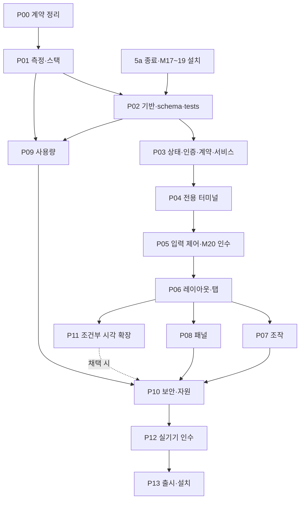

# Workspace v1 implementation plan

상태: 검토용 계획. 2026-11-17. 제품 구현·패키지 설치·실기기 측정은 아직 수행하지 않았습니다. 기준 main은 `1b6f6d279c8ff8a02830f7c5d85cef16376a53a1`, [PR #145](https://github.com/2muni-labs/orchestrator/pull/145) 기준 HEAD는 `bb9993a22f8efa1449db82713555a92fa9662453`입니다. PR과 연결 이슈를 읽은 시점의 사실이며 착수 때 다시 대조합니다.

목표: 기존 orch 터미널과 파이프라인을 Windows·iPhone·iPad에서 같은 상태로 관찰·입력하는 v1을 구현한다. [구현 설계](../design/workspace-implementation.md)의 D01~D09는 새 제안이며 승인 전 구현 계약으로 확정하지 않습니다. 원본은 기존 [구축 절차 4.3](../design/구축%20절차.md), [기술 설계 4.13~4.15](../design/기술%20설계.md), [화면 설계](../design/화면%20설계.md), ADR 0004~0011·0014·0015입니다.

## 1. 조사 결과와 현재 착수 가능 범위

- PR #145는 OPEN이며 direct closing issue는 없습니다. 별도 이력 #302와 결정 #349가 연결점입니다. 해당 프로젝트의 27개 이슈 본문·댓글을 조회했고 후속 댓글은 없었습니다.
- `workspace/`, 서버/클라이언트, workspace CLI는 기준 코드에 없습니다. M17 show/events는 schema 파일이 있어도 실제 명령이 없습니다. roadmap/versions/selfcheck와 input_wait 계약도 선행 계획입니다.
- 기존 `terminal/base.py`, `terminal/tmux.py`, launcher/service는 재사용할 기반이지만 browser streaming·전용 socket·input owner·resize 제어가 구현됐다고 보지 않습니다.
- #145의 ADR 0021/0022는 최신 main의 다른 결정과 충돌합니다. 과거 merge-policy 문구도 최신 규칙으로 대조해야 합니다. 단순 전체 파일 덮어쓰기로 병합하지 않습니다.
- 지금 할 수 있는 일은 P00 문서 정합화와 P01 측정 계획·허용된 throwaway 시제품입니다. 제품 M20은 Phase 5a 종료와 측정 gate를 통과한 뒤 착수합니다. 이 계획은 1주 무인 운용 선행 조건을 생략하지 않습니다.

확정 v1과 #145의 조건부 확장을 별도로 승인·추적합니다. #145가 보류되어도 기존 dwindle/master·탭·플로팅 v1 계획은 유지합니다. 새 요구를 일부만 채택하면 포함/제외 표와 인수 기준을 먼저 변경합니다.

## 2. 착수·종료 gate

| Gate | 필요한 증거 | 미충족 시 |
| --- | --- | --- |
| G0 문서 결정 | D01~D04/D06/D07/D09 결정, ADR 충돌 정리, 구현 계약과 source 문서 일치 | 해당 contract·확장 작업 blocked |
| G1 제품 착수 | M17~M19 설치, M18 안전 리뷰·테스트 경로, 5a 실제 1주 무인 운용 완료([#328](https://github.com/2muni-labs/orchestrator/issues/328)), 기기 분실 런북 | 제품 구현은 기다리고 문서·측정만 준비 |
| G2 스택 확정 | W-M6/W-M7, 실제 후보 스택 S-M3, 자원 예산, 설치 스크립트 차단 설정, 오프라인 sandbox 검증 | [#330](https://github.com/2muni-labs/orchestrator/issues/330)/#331 미완료 |
| G3 M20 인수 | 인증된 읽기 화면+2기기 snapshot/reconnect, input 권한·lock·전용 tmux·크기 제어·host CLI, 실제 sandbox | 화면 확장 M21 착수 보류 |
| G4 M21 인수 | 10종 panel, 공유 레이아웃/탭, usage 범위, 세 기기 시나리오 1~11; D01 승인 시 12~16 | #342와 v1 출시 미완료 |
| G5 설치 | 버전 PR·태그·승인 설치, workspace 재기동·health·lock 보존·복구 시험 | 개발 완료와 운용 전환 구분 |

M20의 기존 선행은 5a 종료·M17/M18·W-M6/W-M7·S-M1/S-M3입니다. M21은 M19/M20·W-M1/W-M2를 요구합니다. W-M3 미확보는 Claude 한도/메인 집계 범위를 unavailable로 제한하는 결정을 기록해야 하며 전체 값을 추정해서 채우지 않습니다. CU6의 2주 시범은 5a의 1주 인수와 별개입니다.

## 3. 기존 27개 이슈의 산출물과 완료 기준

공통 프로젝트: [orch 06 — 작업공간 v1](https://github.com/orgs/2muni-labs/projects/8). 상태는 계획 작성으로 바꾸지 않습니다. 아래 번호는 기존 이슈를 재사용하며 중복 이슈를 만들지 않습니다.

| 이슈 | 계획 연결 | 구체 산출물 / 종료 증거 |
| --- | --- | --- |
| [#302](https://github.com/2muni-labs/orchestrator/issues/302) | P00 | #145의 충돌·ADR·참조 정리, 승인된 문서 PR 머지. 기능 구현 완료와 별개 |
| [#349](https://github.com/2muni-labs/orchestrator/issues/349) | P00 | 비율 분할·공유 fullscreen/pin·host wallpaper 및 예외 행동 결정표 |
| [#350](https://github.com/2muni-labs/orchestrator/issues/350) | P00/P04 | owner resize 규칙, SSH/tmux sizing 측정, 두 기기 크기 충돌 인수 |
| [#351](https://github.com/2muni-labs/orchestrator/issues/351) | P00/P06 | tab_group schema와 생성/이동/해체/닫기/local-only 규칙 및 시험 |
| [#352](https://github.com/2muni-labs/orchestrator/issues/352) | P00/P05 | 실행 명령표, host-only lock/unlock, 정지·재시작·실패 계약 |
| [#406](https://github.com/2muni-labs/orchestrator/issues/406) | P01/P09 | W-M1 Codex 확정 필드·중복·회차 연결·rotation 결과 |
| [#407](https://github.com/2muni-labs/orchestrator/issues/407) | P01/P09 | W-M2 Claude C/main 기록 및 연결 키·usage 필드 결과 |
| [#408](https://github.com/2muni-labs/orchestrator/issues/408) | P01/P09 | W-M3 한도 취득 가능 여부·출처·stale/unknown 표시 결정 |
| [#409](https://github.com/2muni-labs/orchestrator/issues/409) | P01 | W-M6 세 기기 후보 비교, 4 panel/2 terminal 시제품, 잠금·복구·단축키·알림 측정 |
| [#410](https://github.com/2muni-labs/orchestrator/issues/410) | P01/P03 | W-M7 신원·allowlist·TLS/Origin·권한 회수 경로의 재현 결과 |
| [#411](https://github.com/2muni-labs/orchestrator/issues/411) | P01/P03 | S-M3 실제 선택 스택에서 PTY/socket/port/파일 경계의 성공·거부 측정 |
| [#413](https://github.com/2muni-labs/orchestrator/issues/413) | P01/P10 | CPU/RSS/frame/latency/연결·버퍼·보존 예산과 재현 절차 |
| [#416](https://github.com/2muni-labs/orchestrator/issues/416) | P01/P11 | 조건부 시각 확장의 panel/pin 상한·breakpoint·효과·대비·blur 측정 |
| [#330](https://github.com/2muni-labs/orchestrator/issues/330) | P01 | 비교표와 선택/탈락 근거. PWA 1차 선택과 언어/프레임워크 최종 선택 구별 |
| [#331](https://github.com/2muni-labs/orchestrator/issues/331) | P01 | 스택 ADR, pinned dependency 목록, install-script 차단, 필요한 예외 |
| [#332](https://github.com/2muni-labs/orchestrator/issues/332) | P02 | 디렉터리·manifest/lock·shared/safety paths·AGENTS 범위·검증 명령 |
| [#333](https://github.com/2muni-labs/orchestrator/issues/333) | P03 | Tailscale 전용 bind·auth·Origin·launchd·sandbox 실제 시험 |
| [#334](https://github.com/2muni-labs/orchestrator/issues/334) | P04 | 등록 pane만 연결하는 제한 adapter, 전용 socket, 종료 read-only, shell 생성 차단 |
| [#335](https://github.com/2muni-labs/orchestrator/issues/335) | P05 | device permission/owner/epoch/lock/audit, 동시 입력·회수·crash 시험 |
| [#336](https://github.com/2muni-labs/orchestrator/issues/336) | P02/P03 | 메시지·공유 상태·별도 저장소·CLI adapter·버전 격리·resync |
| [#337](https://github.com/2muni-labs/orchestrator/issues/337) | P06 | dwindle/master·tabs·float·workspace·scratchpad·shared/local-only state 및 UI |
| [#338](https://github.com/2muni-labs/orchestrator/issues/338) | P07 | keyboard/touch command mapping·IME·보조 키·iPad keyboard·narrow mode |
| [#339](https://github.com/2muni-labs/orchestrator/issues/339) | P08 | 10종 panel과 데이터 계약, 자동 로그 lifecycle·read-only·오류/빈 화면 |
| [#340](https://github.com/2muni-labs/orchestrator/issues/340) | P09 | session parser·회차 연결·usage/limit/version 화면, 미확정 데이터 표기 |
| [#341](https://github.com/2muni-labs/orchestrator/issues/341) | P10 | redact·마크업/escape·no-cache·허용 필드·자원 상한/보존 검사 |
| [#343](https://github.com/2muni-labs/orchestrator/issues/343) | P11 | D01 승인 범위의 fullscreen/maximize/pin/appearance/wallpaper·host import |
| [#342](https://github.com/2muni-labs/orchestrator/issues/342) | P12/P13 | 세 기기 전체 인수·설치/복구 기록. 실제 버전과 증거로 종료 |

## 4. 작업 분해와 의존 순서

P번호는 **계획 패키지**이며 하나의 큰 orch task가 아닙니다. 표의 task 후보는 각 범위와 검증을 독립 커밋/PR 단위로 확정합니다. `h-`는 메인 소유 shared/docs/schema/manifest 작업입니다. 구현은 메인이 tests·interface를 먼저 확정한 뒤 Codex B 레인에 배분하고, 기존 슬롯 상한을 유지합니다. 아래 등급은 잠정값이며 실제 파일과 safety_paths로 다시 판정합니다.

모든 task 공통 read: 승인된 이 문서·구현 설계·관련 schema·해당 tests·인터페이스. modify는 아래 소유 디렉터리 안의 **정확한 파일**로 spec에 고정하며 `workspace/**` 전체를 한 task에 주지 않습니다. 언어 미정이므로 지금 존재하지 않는 확장자·검증 명령을 실행 가능하다고 적지 않습니다.

| 패키지 / task 후보 | 선행 | 소유 경로 / 등급·담당 | 검증·산출물 |
| --- | --- | --- | --- |
| P00 `h-workspace-contracts` | 조사 완료 | docs/design, docs/decisions, 메인 | D01~D04/D06/D07/D09, source 정합화·기존 이슈 추적 |
| P01 `h-workspace-measurements`, `h-docs-workspace-stack` | P00의 측정 계약 | docs/measurements + docs/decisions, 메인 | W-M1~3/6/7·S-M3·예산, D05/D08 결정. 시제품은 저장소 밖에서 측정 후 제거 |
| P02 `h-workspace-base`, `h-workspace-protocol` | G0/G1/G2 | shared paths·workspace manifest/lock·schemas/workspace·tests, 메인 | 한 번 준비 뒤 offline verify, pipeline 독립 설치, schemas/fixture·stub |
| P03a `m-ws-state` | P02 | server/state, L3/B | transaction·revision·duplicate receipt·crash·migration |
| P03b `m-ws-auth`, `m-ws-transport` | P02, P03a 인터페이스 | server/auth, protocol, L3/B | bind·Origin·identity·회수·capabilities·bounded WS |
| P03c `m-ws-pipeline` | P02 + M17/M19 실제 계약 | server/pipeline, L3/B | stdout schema·unknown version 격리·cursor/reconnect·금지 명령 |
| P03d `h-workspace-service` | P03a~c | host CLI/service·sandbox profile·tests, 메인 | launchd ready/stop/restart·실제 sandbox·다중 target 경계 |
| P04a `h-workspace-terminal-host` | P02, D02, S-M1 재대조 | src/orch/terminal·launcher/service·tests, 메인 | 전용 소켓·registry 최소 출력·SSH 복원 영향. 기존 세션 강제 종료 없이 전환 |
| P04b `m-ws-terminal` | P03, P04a | server/terminal, L3/B | owned pane·stream·dead pane·pty size·tmux prefix 탈출 거부 |
| P05a `m-ws-input-control` | P04b | server/terminal 권한 모듈, L3/B | owner epoch·lock/claim 경합·회수·감사 실패·입력 미전달 |
| P05b `h-workspace-host-controls` | P05a | host CLI/IPC·tests, 메인 | lock/unlock·device 명령·재시작, browser unlock 없음 |
| P05c `m-ws-readonly-shell` | P03 + P05b | client/transport, 최소 panel shell, L2/B | 인증된 2기기 보기·resync·lock 표시; G3 vertical slice |
| P06a `m-ws-layout-state` | G3, D03/D06 | server/state/layout, L3/B | tabs/split/master/float·불변식·local-only |
| P06b `m-ws-layout-view` | P06a | client/layout, L2/B | tree projection·focus/tab·narrow·scratchpad·화면 전환 복원 |
| P07 `m-ws-commands`, `m-ws-terminal-input-ui` | P06b, P05, W-M6 | client/input, L2/B | keyboard/touch/IME·composition/paste·소유권 표시·동일 조작 |
| P08a `m-ws-task-panels` | P03c, P06b | client/panels task/log/detail/diff, L2/B | run lifecycle·기존 계약·안전한 표시 |
| P08b `m-ws-ops-panels` | P03c, P06b, M19 | client/panels process/merge/health/roadmap, L2/B | stale/unknown·commit 기준·대체 작업 집계 |
| P09a `m-ws-usage-parser` | P01 W-M1~3, P02 | server/usage, L3/B | allowlist·중복/누락·rotation·모호한 회차·line 상한 |
| P09b `m-ws-agent-panel` | P09a, P03c | client/panels agents, L2/B | 토큰/한도 분리·출처/시각·unavailable·업그레이드 버튼 없음 |
| P10 `h-workspace-security-acceptance` | P03~P09, 조건부 P11 | tests/security/e2e·안전 경로 결함은 별도 task, 메인 | 캐시/escape/redact·경계·상한·보존·장시간 시험 |
| P11a `m-ws-overlays` | D01 승인, P06 | server/state 및 client/layout을 나눠 별도 task, L3/L2 B | fullscreen/pin 보존·자동 로그·focus 예외 |
| P11b `h-workspace-assets`, `m-ws-appearance` | P11a, [#416](https://github.com/2muni-labs/orchestrator/issues/416) 측정 | host importer/assets L3, client/appearance L2, 메인/B 분리 | decode/경로·asset 인증·대비·effect off·OS 설정 |
| P12 `h-workspace-device-acceptance` | P07~P10, 채택한 P11 | 실기기 수행·docs/measurements, 메인/사용자 | Windows/iPhone/iPad 전체 시나리오·실패 추적 |
| P13 `h-workspace-release` | G4 | 버전/설치 문서·복구 절차, 메인 | 승인 설치·workspace 재시작·health·backup/restore·G5 |

task spec에는 한국어 요약과 영어 코드 식별자를 씁니다.

병렬 가능한 구간은 P03a~c의 인터페이스 확정 뒤, P08a/P08b/P09의 경로가 분리된 부분입니다. state/schema·manifest·CLI와 같은 공유 파일은 메인이 직렬 통합합니다. 이 문서는 에이전트 실행이나 기존 상한 확대를 승인하지 않습니다.

## 5. 측정과 스택 선정 절차

기술 스택을 이 문서에서 임의로 고정하지 않습니다. 후보를 2개 이하로 좁혀 같은 시험을 돌린 뒤 [#330](https://github.com/2muni-labs/orchestrator/issues/330)/#331에 선택 근거를 남깁니다. dependency 이름·정확한 버전·유지 상태·라이선스·설치 스크립트 필요 여부·lock·offline 검증 방법을 포함합니다. Python pipeline의 표준 라이브러리 원칙과 workspace 예외 범위를 분명히 합니다.

| 측정 | 입력/환경 | 기록할 값과 판정 |
| --- | --- | --- |
| W-M1/W-M2 | 승인된 최소·비식별 fixture, 실제 agent version | field 의미·누적/증분·중복·rotation·회차 연결 실패. 원문 로그는 공개하지 않음 |
| W-M3 | 지원되는 한도 조회 경로 | 가능/불가·시각·신선도. 비공개 인증 우회 없이 unavailable 허용 여부 결정 |
| W-M6 | 실제 Windows/iPhone/iPad, 4 panel 중 2 terminal | leader/key 충돌·IME·잠금/앱전환 복구·설치/알림·frame/input latency |
| W-M7 | host + 허용/비허용/회수된 기기 | bind/TLS/identity/Origin·view/input·기존 연결 회수 |
| S-M3 | 선택 스택, 실제 macOS sandbox, 가짜 비밀 | pty/socket/bind 정상, 다른 경로/포트/외부 TCP/홈 쓰기 거부 |
| 예산 [#413](https://github.com/2muni-labs/orchestrator/issues/413) | idle/typical/최대 후보 부하, 24시간 운용 | CPU/RSS 증가·연결/queue/stream 한도·지연·재연결·저장량 |
| 시각 [#416](https://github.com/2muni-labs/orchestrator/issues/416) | 4 panel/2 terminal + pin 1개·배경 이미지·full/save/off·narrow | 대비·최소 크기·panel/pin 한도·breakpoint·blur 방식·OS 접근성 |

시험 전에 workload·수집 간격·측정 기간·통과/중단 기준을 기록하고, 결과를 보고 기준을 낮춰 통과시키지 않습니다. 계획 단계의 후보 값과 승인된 운영값을 분리합니다. 장치 접근 불가이면 미측정으로 남기고 사용자가 실행할 재현 절차를 제공합니다. throwaway 시제품은 삭제하되 결과·환경·재현 절차는 보존합니다.

결과 파일 제안: `docs/measurements/workspace-<measurement-id>.md`. 공통 필드: 날짜, code/agent/runtime/browser/device 버전, 목표, 비밀 없는 명령·fixture, 표본/기간, 값, 실패, 선택·기각 이유, 관련 issue, 검증자, 재측정 trigger. 오늘 작성한 계획을 측정 결과 파일로 위장하지 않습니다.

## 6. 인수 추적표

| 시나리오 | 주 작업 | 통과 근거 |
| --- | --- | --- |
| 화면 1 접속·인증 | P03 | 허용/비허용/회수·Origin·재시작 결과 |
| 화면 2~3 공유 workspace/panel | P06 | 세 기기 tree/tab/focus 일치, local-only 격리 |
| 화면 4 터미널 | P04/P05/P07 | 같은 stream·owner만 입력·touch/keyboard·D02 resize |
| 화면 5 실시간 갱신 | P03/P08 | 중복·유실·cursor gap·unknown version 주입 |
| 화면 6 승인 대기 | P08 | input_wait 반영·메인 terminal 이동·승인 버튼 없음 |
| 화면 7 재접속 | P03/P07 | 잠금/앱전환 뒤 snapshot·키 입력 비재전송 |
| 화면 8 비공개 정보 | P10 | redact 실패 차단·browser 저장소/cache 검사 |
| 화면 9 입력 권한 | P05 | 동시 claim·이전 epoch·권한 회수·감사 metadata |
| 화면 10 잠금 | P05 | lock 응답 후 PTY 입력 없음·재기동 유지·host-only unlock |
| 화면 11 셸 복귀 없음 | P04 | dead pane·prefix/new-window/respawn 탈출 차단 |
| #145 화면 12 동적 배치 | P06/P11 | 패널 5개 열기·2개 닫기, 빈 칸 없음, dwindle/master 왕복 후 방향·비율·패널 보존, 두 넓은 기기 방향 일치 |
| #145 화면 13 전체화면 | P11 | maximize/fullscreen 공유·원상 복원, 승인 대기 가시성, 자동 로그가 모드를 해제하지 않음 |
| #145 화면 14 고정 | P11 | 모든 workspace/fullscreen 위 표시, 좁은 화면 pin 줄·sheet, 해제 시 현재 workspace의 floating |
| #145 화면 15 모양 | P11 | 공유 배경·기기별 효과 off·같은 기능·OS 동작 줄이기 우선 |
| #145 화면 16 가독성 | P11 | 가장 밝은 내장 배경/흰 이미지에서 terminal/log/diff/board 대비 기준 충족 |
| 추가 T01 탭·local-only | P06 | 활성 탭 삭제/이동·마지막 leaf·다른 기기의 삭제·공유 복귀 |
| 추가 T02 데이터 부족 | P08/P09 | unknown/unavailable/stale 표시, 일부 패널만 비활성 |
| 추가 T03 운영 복구 | P03/P13 | crash/DB손상/disk full/감사 실패·migration rollback·pipeline 독립 |

최종 인수 기록은 시나리오 × Windows/iPhone/iPad 행렬로 만듭니다. 각 칸은 pass/fail/not-run과 증거 링크를 가지며, 필수 not-run은 출시 보류입니다. 성공한 emulator·단위 테스트 수만으로 NF-7을 충족했다고 하지 않습니다.

## 7. GitHub 기록과 완료 책임

- 대상은 `2muni-labs/orchestrator`, 프로젝트는 #8입니다. 기존 27개 이슈와 [#328](https://github.com/2muni-labs/orchestrator/issues/328)·M17/M18/M19 선행 이슈를 연결합니다.
- 확정 task가 생기면 runtime 대응표의 task→record→issue/project를 연결합니다. 한 이슈에 여러 task가 있으면 aggregate 책임을 명시합니다.
- PR [#145](https://github.com/2muni-labs/orchestrator/pull/145)/#302는 설계 산출물 책임입니다. 이를 닫았다고 [#343](https://github.com/2muni-labs/orchestrator/issues/343) 구현이나 [#342](https://github.com/2muni-labs/orchestrator/issues/342) 인수를 완료로 바꾸지 않습니다.
- [#350](https://github.com/2muni-labs/orchestrator/issues/350)/#351/#352는 설계 확정과 제품 구현 검증의 완료 조건을 구별합니다. 설계 PR에는 Refs를 쓰고 구현/인수가 남은 이슈를 자동 종료하지 않습니다.
- P00/P01 완료는 선행 준비 완료입니다. 기능 이슈는 해당 scope 구현·검증·머지와 필요한 설치/실기기 증거를 확인한 뒤 종료합니다.
- 단계별 summary·정확한 local state·PR·검증·다음 행동을 메인이 갱신하고, API 실패는 pending으로 남깁니다. GitHub 상태가 orch 실행을 승인하지 않습니다.

## 8. 다음 실행 묶음

1. #349에서 D01 범위와 ADR 번호 충돌 처리안을 결정하고 #302와 연결한다.
2. [#350](https://github.com/2muni-labs/orchestrator/issues/350)/#351/#352 및 #336에 D02~D04/D06/D07의 계약 제안을 검토해 source 문서 정합화 PR을 만든다.
3. [#409](https://github.com/2muni-labs/orchestrator/issues/409)/#410/#411/#413/#416의 측정 절차와 실제 기기 접근을 준비한다. 병행 가능한 W-M1~3도 최소 fixture로 시작한다.
4. [#330](https://github.com/2muni-labs/orchestrator/issues/330)/#331의 측정 결과와 스택 ADR이 확정되면 G1 증거를 다시 확인한다.
5. [#332](https://github.com/2muni-labs/orchestrator/issues/332) 기반 하네스부터 tests/schema/stub를 확정하고 P03~P05의 read-only→제한 입력 vertical slice를 구현한다.

날짜를 고정한 출시 약속은 두지 않습니다. 실제 1주 운용·실기기 측정·기술 선택의 완료가 critical path입니다. 작업 규모는 P00/P01 뒤 정확한 파일·인터페이스·검증 시간이 생길 때 산정합니다.
