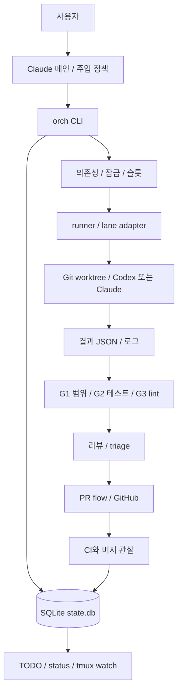

# 아키텍처와 데이터 흐름

[English](architecture.md) | 한국어

기준: `b757a619`, 2026-11-18. 현재 백엔드는 로컬 Python CLI와 subprocess,
SQLite, tmux, launchd로 구성된다. 상시 HTTP API 서버나 웹 프런트엔드는 없다.

## 구성과 소유권

메인은 계획·인터페이스·테스트·승인 판단을 맡고 구현 에이전트는 확정된 범위만
수정한다. 실행 상태는 DB, 설명과 확인된 전제는 task spec, 실행 결과는 result,
리뷰 근거는 review/triage, 실제 변경은 git에 남는다. GitHub는 협업용 표현이다.

| 계층 | 모듈 | 책임 |
| --- | --- | --- |
| 진입점 | cli, config, taskfile | 인자/설정/spec 검증, 대상 선택, 명령 조합 |
| 상태 | models, store | 허용 전이, 트랜잭션, 실행·게이트·pause 기록 |
| 실행 제어 | lifecycle, scheduler, runner | worktree 수명, 예약·충돌, 프로세스·보고서 |
| 외부 실행 | lanes/base, lanes/codex, lanes/claude | 명령 구성, 환경 정리, 모델·effort |
| 검증 | gate, sandbox, review, results | 범위, 테스트·lint 격리, 결과·리뷰 해석 |
| Git/GitHub | gitops, github, prflow, waiter, credentials | 변경·PR·인증·원격 상태 관찰 |
| 관측/운용 | render, watch, terminal, doctor, service, gc, notify | 파생 뷰·tmux·건강 점검·정리·알림 |
| 안전 정책 | guard, hooks, redact | 훅 입력과 명령 검사, 출력의 민감 정보 제거 |
| 작업 추적 | tracking, tracksync | 대응표와 동기화 엔진; CLI/상시 서비스 연결은 별도 |

## 작업 수명

주 경로는 `prepared → reserved → running → judging → gating → ready → pr_open
→ closed`다. 예약 조건이 부족하면 `queued`, 리뷰가 필요하면 gating 이후
`reviewing`을 거친다. 오류·차단에는 `blocked`, `conflict`, `orphaned`, 폐기에는
`discarded`가 있다. 세부 전이는 [models.py](../../src/orch/models.py)를 따른다.

`prepare`는 지시서를 검증하고 worktree 및 setup을 준비한다. 일반 작업의 dispatch는
테스트/stub commit이 정확히 하나인지 확인한다. L1의 명시적 tests=none 예외는
별도 정책을 따른다. scheduler는 트랜잭션 안에서 선행 작업의 closed, 수정 경로
충돌, 전체/B 레인 슬롯, pause를 검사한다. 현재 next 순서는 오래된 queued 작업
우선이며 priority 기반이 아니다. 예약이 만료되면 queued로 돌아간다.

runner는 레인 adapter의 argv/env로 에이전트를 실행하고 실행별 로그를 남긴다.
결과가 유효하면 결과를 우선 해석하며, 보고서가 없을 때 사용량 제한 감지 등으로
실패 원인을 분류한다. BLOCKED와 사용량 제한은 명시적 복구 판단을 기다린다.
재시도는 테스트 기준점과 시도 기록을 관리하며 무제한 재실행하지 않는다.

G1은 변경 범위와 tests 보호를 확인하고 G2/G3는 대상의 테스트/lint를 수행한다.
게이트 통과 후 orch가 구현 변경을 commit한다. 리뷰 PASS 또는 승인된 triage
절차 후 PR 단계로 이동한다. PR push 성공, required CI 통과, 리뷰, merge,
설치·실환경 인수는 서로 다른 사실이다. 이들을 하나의 완료 상태로 섞지 않는다.

## 저장 구조와 일관성

SQLite는 WAL, foreign keys, busy timeout을 사용한다. migration은 `user_version`으로
관리하며 더 새로운 DB 스키마는 거부한다. 상태 전이는 예상 상태를 확인하고
이벤트를 기록한다. `BEGIN IMMEDIATE`로 쓰기 경쟁을 조절한다.

| 자료 | 저장 내용 / 역할 |
| --- | --- |
| tasks | target, 상태, grade/lane/model, depends_on, 기준/테스트/푸시 SHA, PR |
| runs | 시도별 프로세스·시각·결과·실패 이유 |
| locks | target과 task별 수정 glob 잠금 |
| gate_results / events | 게이트 결과와 전이 이력 |
| pauses / doctor_checks | 실행 차단 이유와 건강 점검 |
| tracking_* | target/project/record/task/alias 매핑, 검증된 sync 상태·실패 이력 |
| task/result/review 파일 | 확정 지시서, 요약 보고서, 리뷰·triage 근거 |
| TODO.md | DB에서 다시 생성하는 뷰; 원본으로 수정하지 않음 |
| plans/*.md | 메인 소유 우선도·외부 의존조건·변경 이력; 런타임 parser 대상 아님 |

tracking JSON은 import/recovery 입력이고 DB 실행 상태를 덮어쓰는 제어 문서가
아니다. sync가 소유한 진행 블록과 메인이 소유한 Planning 블록을 구분한다.
외부 API 쓰기는 로컬 트랜잭션과 원자적이지 않으므로 성공 후 read-back과 실패
기록으로 확인한다. 단순히 요청을 보냈다는 이유로 동기화 완료로 기록하지 않는다.

## 격리와 외부 경계

Git worktree는 변경을 분리하고 scope gate는 수정 경계를 검증한다. OS sandbox는
테스트 명령의 파일/네트워크 접근을 제한한다. 둘은 역할이 다르다. Codex 실행은
현재 adapter의 workspace-write, 리뷰는 read-only를 사용한다. 계획 중인 orch
네트워크 proxy가 현재 적용된 것으로 간주하지 않는다.

에이전트 환경에서 토큰을 제거하고 공개 GitHub 출력은 redact 정책을 거친다.
훅·guard는 메인 도구 사용 정책을 추가로 적용한다. 모든 보호가 단일 계층에서
완결된다고 가정하지 않으며 실제 sandbox 검증과 외부 바이너리 측정이 필요하다.
세부 위협 모델은 [보안 설계](../design/보안%20설계.md)를 참조한다.
