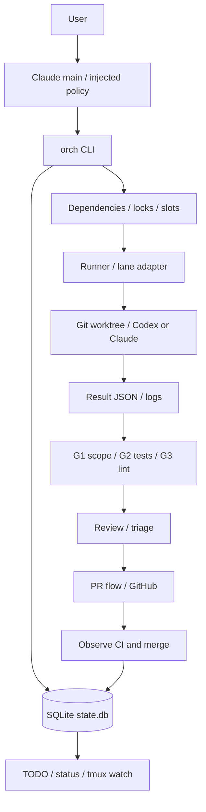

# Architecture and data flow

English | [한국어](architecture.ko.md)

Baseline: `1c191614`, 2026-11-18. The current backend consists of a local Python CLI,
subprocesses, SQLite, tmux, and launchd. There is no persistent HTTP API server or web frontend.

## Components and ownership

The main agent owns planning, interfaces, tests, and approval decisions; implementation
agents modify only the confirmed scope. The DB owns execution state, task specs hold
confirmed premises, results summarize execution, reviews/triage hold review evidence,
and Git holds actual changes. GitHub presents work for collaboration.

| Layer | Modules | Responsibility |
| --- | --- | --- |
| Entry | cli, config, taskfile | Validate arguments/settings/specs, select target, compose commands |
| State | models, store | Allowed transitions, transactions, run/gate/pause records |
| Execution control | lifecycle, scheduler, runner | Worktree lifetime, reservations/conflicts, processes/reports |
| External execution | lanes/base, lanes/codex, lanes/claude | Command construction, environment filtering, model/effort |
| Verification | gate, sandbox, review, results | Scope, isolated tests/lint, result/review interpretation |
| Git/GitHub | gitops, github, prflow, waiter, credentials | Changes, PRs, authentication, remote-state observation |
| Operations | render, watch, terminal, doctor, service, gc, notify | Derived views, tmux, health, cleanup, notifications |
| Safety policy | guard, hooks, redact | Hook input/command inspection and output redaction |
| Work tracking | tracking, tracksync | Bindings and sync engine; service wiring is separate |

## Task lifecycle

The main path is `prepared → reserved → running → judging → gating → ready → pr_open
→ closed`. Insufficient reservation conditions lead to `queued`; required reviews
pass through `reviewing` after gating. Exceptional states include `blocked`, `conflict`,
and `orphaned`; discarded work enters `discarded`.
[models.py](../../src/orch/models.py) defines the exact allowed transitions.

Prepare validates the specification and creates the worktree/setup environment.
Normal dispatch checks that there is exactly one test/stub commit. The explicit L1
`tests=none` exception follows its own policy. Within a transaction, the scheduler
checks closed predecessors, overlapping modify paths, total/B-lane slots, and pauses.
Next currently visits the oldest queued tasks first; it does not use priority.
Expired reservations return to queued.

The runner executes lane-specific argv/env and writes a log for each run. Valid results
take precedence; absent reports trigger classification such as usage-limit detection.
BLOCKED and quota outcomes await explicit recovery decisions. Retry retains test-baseline
and attempt records; it is not unlimited re-execution.

G1 checks changed scope and frozen tests; G2/G3 execute target test/lint commands.
After gates pass, orch commits implementation changes. Review PASS or approved triage
allows the PR stage. A successful push, required CI, review, merge, installation, and
real-world acceptance are separate facts and must not be collapsed into one completion claim.

## Storage and consistency

SQLite uses WAL, foreign keys, and a busy timeout. Migrations use `user_version` and
reject a schema newer than the running code. State transitions check the expected
state and record events. `BEGIN IMMEDIATE` coordinates writers.

| Data | Contents / role |
| --- | --- |
| tasks | Target, state, grade/lane/model, depends_on, base/test/pushed SHAs, PR |
| runs | Per-attempt process, times, outcome, failure reason |
| locks | Modify-glob locks by target and task |
| gate_results / events | Gate results and transition history |
| pauses / doctor_checks | Dispatch pauses and health checks |
| tracking_* | Target/project/record/task/alias mappings, verified sync state and failures |
| Task/result/review files | Confirmed specification, summary reports, review/triage evidence |
| TODO.md | Regenerated DB view; never edit as authority |
| plans/*.md | Main-owned priorities, external dependencies, history; not parsed by runtime |

Tracking JSON is import/recovery input, not a control document overriding execution
state. Keep sync-owned progress blocks separate from main-owned Planning blocks.
Remote API writes are not atomic with local transactions; verify through read-back
and record failures. Sending a request alone does not establish synchronization success.

## Isolation and external boundaries

Git worktrees isolate changes; scope gates verify modification boundaries. The OS
sandbox restricts file/network access by verification commands. These protections have
different roles. The current Codex adapter uses workspace-write for implementation
and read-only for review. Do not assume the planned orch network proxy is active.

Agent environments remove tokens, while public GitHub output passes redaction policy.
Hooks and guards add main-tool policy enforcement. No single layer supplies all
protection: real sandbox checks and external binary measurements remain necessary.
See the [security design](../design/보안%20설계.md) for the threat model.
